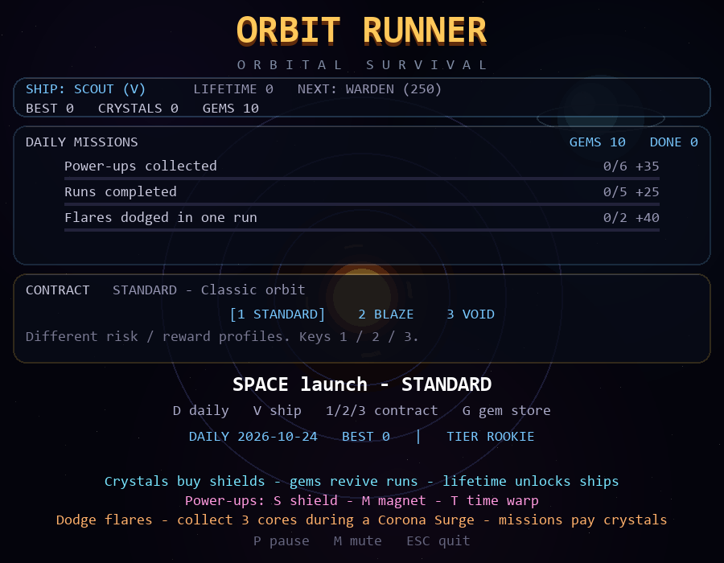
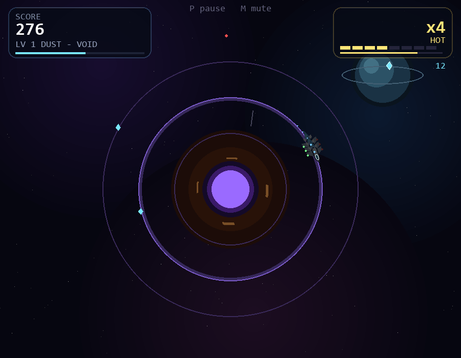
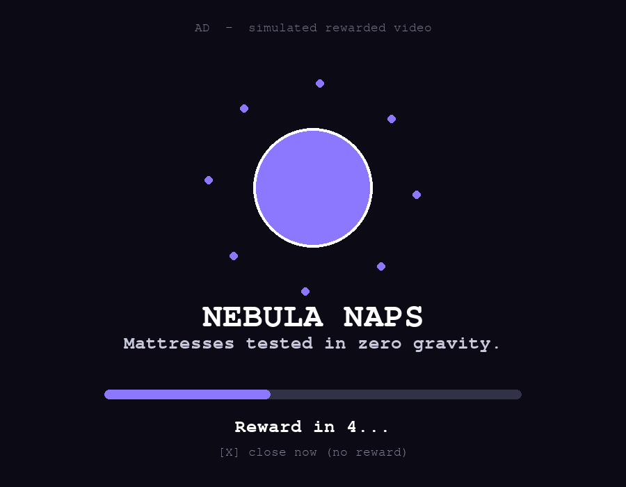

# Orbit Runner

Arcade orbit-dodger with gem-powered continues, campaign sectors, daily missions
and meta-progression.







- `web/` - installable mobile web app (PWA). See `web/README.md`.
- `desktop/` - Python/pygame version.

**Play online:** https://ayinkxlab.github.io/orbit-runner/

## Controls

| Action | Desktop | Mobile |
|---|---|---|
| Outer ring | `Up` / `W` | swipe up |
| Inner ring | `Down` / `S` | swipe down |
| Reverse orbit | `Space` | tap |
| Pause | `P` | `II` button / leave the tab |
| Mute | `M` | `M` button |
| Ship | `V` | `SHIP` button |
| Contract | `1` / `2` / `3` | contract buttons |
| Daily challenge | `D` | `DAILY CHALLENGE` button |
| Quit | `Esc` | close the tab |

## How to play

**Goal:** survive as long as you can, dodge meteors and burning solar flares, collect
crystals, and build a high score. A collision can end your run, so keep moving and
watch the warnings.

### Your first run

1. Open [Orbit Runner](https://ayinkxlab.github.io/orbit-runner/) and start a classic run.
2. Move between the three orbital rings to avoid incoming meteors. Use the controls
   below to move outward or inward.
3. Tap or press Space to reverse your orbit when you need to change direction.
4. Collect the glowing crystals. Each pickup adds points and increases your combo;
   a higher combo means more points per crystal.
5. Read the solar-flare warning. It names the ring about to burn and shows the time
   remaining. Move to another ring before the countdown ends.
6. Collect power-ups when it is safe: shields protect against a hit, magnets help
   gather crystals, and time warp slows meteors temporarily.
7. Keep going as levels rise. Every five levels, a **Corona Surge** asks you to
   collect three golden cores before time runs out.
8. When the run ends, review your score and rewards. Use crystals for progression,
   complete missions, and try again to beat your best.

### Tips for new pilots

- **Look ahead:** watch the meteor paths and flare countdown, not just your ship.
- **Change rings early:** don't wait until a meteor is right beside you.
- **Protect your combo:** collect crystals and dodge hazards to keep the multiplier going.
- **Learn the rings:** Up/W moves outward; Down/S moves inward. Space reverses orbit.
- **Start with STANDARD:** BLAZE adds frequent flares, while VOID makes meteors faster.
- **Pause whenever needed:** press P on desktop or use the on-screen pause control.
- **Try the campaign:** from the web title screen, open the campaign/star map, choose
  an unlocked sector, and launch it. Complete a run to chart sectors, unlock routes,
  discover story entries, and optionally explore planets. The desktop build opens
  its campaign map with C; use Left/Right to select a sector, Space to launch an
  unlocked sector, and B to return.
- **Daily and ranked runs are competitive:** their loadouts and rules are fixed;
  purchased shields and revives do not apply.

## The loop

- **Three rings, endless meteors, crystals and a combo multiplier.** Combo decays
  after 6 seconds instead of resetting instantly when a crystal expires.
  Near-misses and flare dodges build combo too.
- **Power-ups:** shield (one hit), magnet (pulls crystals from neighbouring rings
  for 8s), and time warp (halves meteor speed for 6s).
- **Solar flares:** a ring is telegraphed for ~2.6s, then burns. Be elsewhere for
  a bonus; staying costs a shield or a life.
- **Corona Surge:** every 5 levels, collect 3 golden cores before the 14s timer
  ends for a large score/crystal bonus.
- **Run contracts:**
  - `STANDARD` - classic rules
  - `BLAZE` - flares every ~9s, +40% score
  - `VOID` - meteors +25% faster, 2x crystals
- **Ships unlocked by lifetime crystals:**
  - `SCOUT` - balanced
  - `WARDEN` (250) - starts with a shield, longer combo
  - `DRIFTER` (700) - wider magnet, faster ring shifts
  - `GAMBLER` (1500) - crystals worth 2x, but no starting shield
- **Daily missions:** three rotating objectives with crystal rewards. Every five
  completed missions grants 10 gems.
- **Daily challenge:** a deterministic seed for the local date, with its own best
  score and a "new daily best" badge.
- **Ghost:** your best classic run is replayed as a translucent ship while you
  play, so you can race it.
- **Gem Store:** four gem packs (`80 / 240 / 650 / 1800`), plus a rewarded ad
  for 5 gems. Native builds use App Store / Play Store billing; browser builds
  show a clearly labelled demo store.
- **Gem revives:** the first revive costs 5 gems. Each additional revive in the
  same run doubles the price: 5, 10, 20, 40 ... capped at 320. Gems never affect
  ranked or daily runs.
- **Ads:** rewarded ads can add gems in the store or double the crystals from a
  completed run. Ads are capped per session.
- **Juice:** hit-stop, screen flash, power-up trails, combo sound tiers, a subtle
  procedural beat, and auto-pause when the window loses focus.

### Hazard readability

Solar-flare telegraphs identify both the target ring and remaining time with
shape-based and text cues, so players do not need to rely on color alone.

### Corona Surge feedback

The boss HUD clearly states the core-collection objective, shows progress and a
shrinking timer bar, and switches to an urgent text cue in the final four seconds.
Boss timing, rewards and competitive rules are unchanged.

### Combo milestone feedback

Combo callouts now mark the x2, x4, x6 and x8 milestones with distinct tier names.
This makes the current streak easier to read during play without changing combo
timing, scoring, rewards, or competitive rules.

### Core gameplay first-run pacing

The first classic tutorial run uses a gentler meteor cadence and speed to help new
players learn ring movement, reversing, crystals and flare cues. This assist ends
with the tutorial and does not change daily or ranked challenge rules.

### Campaign pause guidance

The pause screen names the active campaign sector and repeats its current objective,
so players can resume with the next milestone in mind. Standard, daily and ranked
runs keep their existing pause layout and rules.

### Living-universe campaign

- The web campaign includes a four-sector star map, story archive, optional planetary
  surveys, sector mastery, and a campaign ending.
- The desktop/Pygame build now reads and writes the same versioned campaign progress
  shape as the web save: completed sectors, selected sector, story discoveries, and
  optional survey IDs. Desktop campaign runs use the matching sector biome and record
  the sector/story when the run ends.
- Desktop campaign map controls: press `C` from the title screen, use `Left`/`Right`
  to select a sector, `Space` to launch an unlocked sector, and `B` to return.
- Existing desktop saves are migrated safely; unknown sector/objective IDs and
  out-of-order completions are discarded. Saves remain local to each platform; this
  shared schema makes campaign progress portable for future import/export tooling but
  does not automatically sync files between devices.

- The story archive presents the existing sector discoveries as one signal chain, with a recovery meter and the next unrecovered lead. It reuses the campaign discovery IDs and does not add a separate save format.
- The web galaxy map uses the existing sector positions to draw connected routes, distinguish locked and charted systems, and show the selected sector's objective without duplicating campaign progression or save data.
- Planetary surveys show sector-specific environmental conditions, hazards, research focus, and field notes while reusing the existing 12 optional objectives and rewards.
- Campaign boss encounters now use sector-specific profiles, with distinct core movement, target-ring patterns, timers, and names. Daily/ranked runs keep the standard Corona Surge profile.
- The existing cosmetics shop has a live preview for ship skins, trails, and titles. Preview selection does not equip or purchase an item; the existing BUY/EQUIP action remains explicit.
- The title screen links to a pilot badge board with progress derived from existing run stats, campaign discoveries, surveys, lifetime crystals, and cosmetics. Achievements add no separate save schema or gameplay advantage.

### Realism pass

- **Orbital motion:** inner rings orbit faster (Kepler-style), reversing has
  angular inertia, and ring changes use a spring-damper radial move.
- **Meteor physics:** falling rocks accelerate toward the star, curve with
  angular momentum, rotate as irregular polygons, and use swept collision so
  fast rocks cannot tunnel through the ship.
- **Visuals:** layered parallax starfield, shooting stars, a ringed planet,
  additive nebula clouds, corona prominences, glowing rings, aircraft liveries
  with exhaust/banking, rock tails/craters, ship afterimages, magnet beams,
  shockwaves, combo callouts and a vignette.
- **UI:** glass panels, segmented combo/level meters, crystal and power-up chips,
  a run-grade badge (`S` to `E`), tier badges (`ROOKIE` to `DIAMOND`), richer
  leaderboard rows with rank medals/avatars, and a product-style game-over card.
- **Audio:** layered bass/arp pads, noise bursts for impacts/flares/shields,
  combo-tier gem sounds, and a level-scaled music pulse.
- **Real rewarded ads:** a native AdMob provider for Capacitor builds with
  consent, reward-event handling and preloading; browser builds keep the
  simulated ad until an ad unit id is configured.
- **Gem billing:** a `CdvIapProvider` for consumable gem packs through
  `cordova-plugin-purchase`; browser builds use a labelled demo store. Product
  IDs and store setup are documented in [`web/README.md`](web/README.md).

The screenshots in `desktop/` are produced by `--selftest --shots`.

## What gems do

Gems are the premium revive currency. They are separate from crystals so the
gem store never buys a leaderboard advantage.

- A revive costs 5 gems, then 10, 20, 40 ... each time the price doubles.
- If the wallet is short, the game-over screen opens the Gem Store and keeps
  the run alive while you buy or watch an ad.
- Gems can be earned from every fifth completed mission (10 gems) and from the
  rewarded ad in the Gem Store (5 gems).
- Ranked and daily runs still have no revives, ads, purchased shields or loadout
  perks.

## What crystals do

Crystals are both the score engine and the meta-currency:

1. **In a run:** each pickup gives `25 x combo` points, raises the combo up to
   `x8`, and refreshes the combo timer. Near-misses and flare dodges also keep
   the combo alive, so crystals are the safest way to build a big multiplier.
2. **At the end of a run:** the crystals you collected are banked. Bank crystals
   buy a starting shield on the title screen (25).
3. **Lifetime crystals** (every crystal ever collected) unlock ships:
   `WARDEN` at 250, `DRIFTER` at 700, `GAMBLER` at 1500.
4. **Missions** ask for crystal counts and pay out bank crystals.
5. In ranked/daily runs crystals still add score and count toward missions and
   lifetime unlocks, but the loadout is fixed so nobody can buy an advantage.

## Competitive mode

The web version has an online ladder built for rivalry:

- **Ranked Weekly** - fixed `SCOUT` + `STANDARD` loadout, deterministic weekly
  seed, one life, no ads, no continues. Everyone plays the same run.
- **Daily Challenge** - the same fair rules with a fresh seed every day.
- **Leaderboards** - Weekly, Daily and Friends tabs, rank/total score, your row
  highlighted, local fallback when offline.
- **Facebook login** - public profile plus optional `user_friends`; the access
  token is sent only with a score submission and is never stored in the browser
  save.
- **Challenge links** - `?ranked=2026-W43` and `?daily=2026-10-23` open the same
  seed so friends can fight the exact same run. `SHARE CHALLENGE` uses the native
  share sheet or clipboard.
- **Weekly leagues** - 30-player divisions with top-5 promotion and bottom-5
  relegation, shown as a fourth leaderboard tab.
- **Rival ghost** - submit your best line, then race the current #1 ghost from
  the leaderboard.
- **Run tokens** - the server issues a one-use token when a ranked/daily run
  starts; score submissions without a valid token are rejected.
- **Server validation** - `server/orbit_server.py` verifies the Facebook token,
  seed, fixed loadout, one-life rules, plausible stats and unique run ids before
  accepting a score. Scores live in SQLite; the API supports pagination,
  token-verified account deletion (`POST /api/delete`) and event logging.

Configure `web/config.js` with your Facebook App ID and score-server URL, then
follow [`server/README.md`](server/README.md). Without those values the game
still runs offline with a personal local board.

### Onboarding, style and retain

- First-run tutorial with contextual prompts, a guaranteed first crystal and a
  delayed first flare.
- Biomes (`NEBULA`, `PULSAR`, `RED GIANT`, `VOID`, `ICE FIELD`) with distinct
  visuals and speed/score/gem modifiers.
- Meteor varieties: iron (double near-miss score), ice (slow), gold (drops
  crystals), volatile (chain explosion) and splitter (splits on approach).
- Crystal shop: trails, ship skins and titles. Cosmetic-only; no ranked
  advantage.
- Settings: colour-blind flare cues, reduced motion (no screen shake, full-screen flash overlays, or impact hit-stop pauses), low-FX mode, music and SFX.
- Share result cards (PNG) and challenge links, plus PWA install prompt and
  manifest shortcuts.
- Local analytics counters plus server event logging for the run/board/install
  funnel.

### Honest limitation

The server validates the shape of a run but does not replay the game simulation.
A determined cheater can still forge a plausible score. For prizes or a serious
ladder, record inputs and replay them server-side, or add signed device
attestation.

## Run it

Desktop:

```bash
pip install -r desktop/requirements.txt
python desktop/orbit_runner.py
```

Web:

```bash
cd web
python -m http.server 8000
```

Open http://localhost:8000.

## Platforms

| Platform | How it runs |
|---|---|
| **Windows / macOS / Linux browser** | `web/` — Chrome, Edge, Firefox, Safari |
| **iPhone / iPad (iOS)** | Safari → Add to Home Screen, or the Capacitor iOS build |
| **Android phone/tablet** | Chrome → Install app, or the Capacitor Android build |
| **Windows / macOS / Linux desktop** | `python desktop/orbit_runner.py` or a PyInstaller executable |
| **Server** | Python 3.10+ on any OS, or Docker |

### Desktop builds

```bash
pip install -r desktop/requirements-build.txt
python desktop/build.py
```

`build.py` produces `dist/OrbitRunner.exe` on Windows, `dist/OrbitRunner.app`
on macOS, and `dist/OrbitRunner` on Linux. A frozen build stores its save in the
platform user-data directory (`%APPDATA%`, `Application Support`, or
`$XDG_DATA_HOME`). The desktop version uses fallback monospace fonts on systems
without Consolas/Menlo.

### Native iOS / Android

The PWA is installable with no store. For store builds, the `web/` folder is a
ready Capacitor webDir:

From the repository root:

```bash
npm install
npx cap add android
npx cap add ios          # macOS + Xcode only
npm run cap:sync
npm run cap:android
npm run cap:ios
```

`capacitor.config.json` sets the app id, app name, `https` Android scheme and
AdMob initialization. Native builds use the real `AdMobProvider` when
`admobRewardedId` is configured; browsers fall back to the mock ad.

### PWA

The manifest, service worker, safe-area layout, touch/pointer controls, iOS
audio unlock, fullscreen button and install shortcuts cover phones, tablets,
laptops and desktop browsers. Serve over HTTPS (or `localhost`) for PWA install
and service-worker support.

## Tests

```bash
# Python: 21 tests covering accounting, save migration, missions, gems,
# contracts, ships, daily seed, flares, shields, boss surges and ghosts
python -m unittest discover -s desktop -p "test_*.py" -v

# Headless scripted playthrough (also regenerates screenshots with --shots)
python desktop/orbit_runner.py --selftest
python desktop/orbit_runner.py --selftest --shots

# Web: 38 Node tests for gameplay, missions, gem continues and store,
# ranked mode, boards, AdMob, biomes, tutorials, shop and settings
cd web && npm test

# Score server: 21 tests for seeds, validation, SQLite ranking, pagination,
# deletion, duplicates, rate limits, leagues, ghosts, tokens and events
python -m unittest discover -s server -p "test_*.py" -v
```

## Layout

| Path | Purpose |
|---|---|
| `desktop/orbit_runner.py` | Pygame game, ad interface, selftest |
| `desktop/build.py` | PyInstaller build for the current OS |
| `desktop/test_orbit_runner.py` | Headless Python regression tests |
| `desktop/orbit_*.png` | Screenshots produced by `--selftest --shots` |
| `web/game.js` | Canvas game, ad interface, ranked/leaderboard client |
| `web/config.js` | Facebook App ID, score-server URL, AdMob IDs |
| `capacitor.config.json` | Native iOS/Android wrapper settings |
| `package.json` | Capacitor dependencies and native scripts |
| `web/test/game.test.js` | Node test suite |
| `web/index.html` | Page shell, safe-area layout |
| `web/sw.js` | Versioned offline cache / update handling |
| `web/manifest.json` | Install metadata |
| `server/orbit_server.py` | Score API, Facebook verification, leagues, tokens, events |
| `server/test_server.py` | Server unit tests |
| `server/README.md` | Facebook app + deployment guide |
| `server/Dockerfile` | Container image for the score API |
| `docker-compose.yml` | Local/production service definition |
| `.github/workflows/ci.yml` | Web, desktop and server test pipeline |

## Release validation checklist

Before publishing a web/PWA or desktop release:

1. Run web, desktop, and server tests from the commands above.
2. Confirm the campaign star map, story archive, optional surveys, mastery, and ending
   work from a clean save and a migrated existing save.
3. Verify the desktop campaign map and save validation, including sector unlock order.
4. Test keyboard and touch controls, pause-on-tab-switch, reduced-motion and low-FX
   settings, colour cues, audio toggles, and the screen-reader status announcements.
5. Test the PWA offline after first load and confirm the service-worker cache version
   changes with the release.
6. Check phone safe areas, narrow screens, desktop window sizes, and the latest
   Chrome/Firefox/Safari/Edge versions available to the release team.
7. Review third-party service configuration, ad/IAP consent and reward handling, and
   privacy disclosures before enabling production integrations. The demo store and
   mock rewarded ads are not production billing/ad integrations.
8. Choose and add a license before public distribution; verify asset and store listing
   rights for the target platforms.

## Notes

- The service worker uses a versioned cache and network-first navigation. Bump
  `CACHE` in `web/sw.js` when deploying a new asset set.
- The `AdMobProvider` sketch is a starting point, not a production integration.
  Verify the API against your installed `@capacitor-community/admob` version,
  initialize the SDK, grant rewards from the SDK's reward event, and add the
  required consent/ATT flow.
- The online ladder, leagues, rival ghosts, gem store, cosmetics shop, settings, share cards
  and install prompt are in the web/PWA build. The desktop build keeps gameplay
  and visual parity (biomes, meteor varieties, aircraft, effects) but is offline.
- There is no license file in the repository yet; pick one before publishing.
