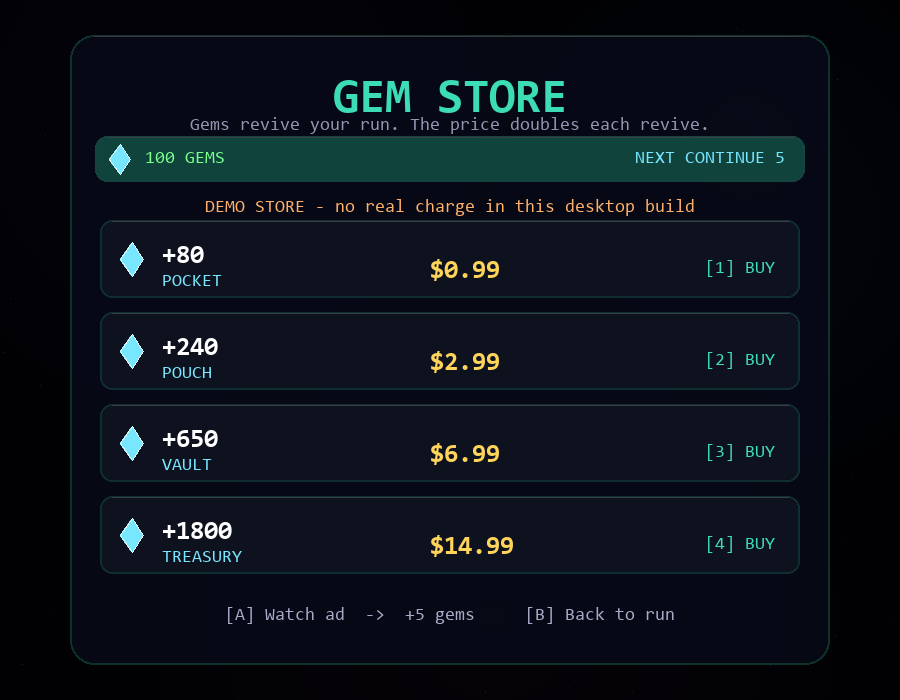

# Orbit Runner - app version

A phone-ready version of the game that you can install. It has touch controls,
portrait layout, vibration, offline support, power-ups, solar flares, Corona
Surges, daily missions, run contracts, ship unlocks, a best-run ghost, weekly and
daily ranked ladders, Facebook login, a Gem Store and gem-priced revives that
double after every use. The same systems are mirrored on desktop.




**Controls:** swipe up/down to change ring, tap to reverse. Keyboard: arrows or
W/S, Space to reverse, `P` pause, `M` mute, `V` ship, `1/2/3` contract,
`R` ranked, `L` leaderboard, `D` daily, `C` shop, `G` Gem Store. On the
leaderboard: `1/2/3` tabs, `F` connect Facebook, `R` refresh, `B` back.

## Accessibility and performance

- The canvas can receive keyboard focus. Its accessible description summarizes the main
  keyboard/touch controls, and a polite screen-reader status announces major screen and
  pause changes. Menus still render inside the canvas, so visual controls and shortcut
  labels remain important.
- Settings include colour-blind cues, reduced motion, low-FX, music and SFX toggles.
  Reduced motion disables screen shake, afterimages and drifting sky; low-FX reduces
  particles, stars and background layers.
- When the page becomes hidden, gameplay auto-pauses and the animation loop stops.
  Returning to the page resumes rendering without applying the hidden time to the run.
- The service-worker cache version must be incremented whenever shipped web assets
  change so installed copies fetch the new release.

## Platform support

- **Phone/tablet:** iOS Safari, Android Chrome, installed PWA, or Capacitor.
- **Laptop/desktop:** Chrome, Edge, Firefox and Safari on Windows, macOS and Linux.
- **Input:** touch swipe/tap, mouse drag/click, keyboard, on-screen pause/mute/shop/install.
- **Display:** safe-area insets for notches, DPR-aware letterboxed canvas,
  responsive resize, fullscreen button in Settings, portrait PWA orientation.
- **Offline:** service worker + local save; updates use versioned network-first
  navigation.
- **Audio:** Web Audio with `webkitAudioContext` fallback and resume-on-gesture
  for iOS.

## 1. Try it on your computer

From the repository root:

```bash
cd web
python -m http.server 8000
```

Open http://localhost:8000. To get the phone view, press F12 and turn on the
device toolbar.

## 2. Put it on your phone (free, no app store)

The game has to be online over HTTPS before a phone can install it:

1. Drag the `web` folder onto https://app.netlify.com/drop (or publish it with
   GitHub Pages). Keep `index.html`, `game.js`, `manifest.json`, `sw.js` and the
   icons together.
2. Open the link on your phone.
   - **Android (Chrome):** menu -> *Add to Home screen* / *Install app*
   - **iPhone (Safari):** Share -> *Add to Home Screen*
3. It opens full-screen from its own icon and works offline.

When you deploy an update, bump `CACHE` in `sw.js` (for example `v10` -> `v11`) so
installed clients pick up the new files.

## Competitive mode / Facebook

The web build has a weekly ranked ladder, a daily ladder and a Friends tab.

- **Ranked Weekly:** fixed `SCOUT` + `STANDARD` loadout, deterministic weekly
  seed, one life, no ads, no continues. Everyone gets the same run.
- **Daily Challenge:** same fair rules, fresh seed per day.
- **Leaderboards:** Weekly / Daily / Friends, with a local personal fallback when
  offline or before the server is configured.
- **Facebook:** profile name/picture, optional `user_friends`; the access token
  is kept in memory and sent only with a score submission.
- **Challenge links:** `?ranked=2026-W43` and `?daily=2026-10-23`.
- **Leagues:** 30-player weekly divisions, top-5 promotion, bottom-5 relegation.
- **Rival ghost:** race the current #1 line from the leaderboard.
- **Run tokens:** ranked/daily starts obtain a one-use server token; submissions
  without it are rejected when `RUN_TOKENS=1`.
- **Share:** score-card PNG, native share sheet, clipboard and challenge links.
- **Onboarding:** contextual first-run tutorial with a guaranteed crystal.
- **Biomes / meteors:** five star biomes, iron/ice/gold/volatile/splitter rocks.
- **Crystal shop:** trails, ship skins and titles (cosmetic only).
- **Gem Store:** four gem packs, a rewarded gem ad, and gem-priced revives that
  double each time (5, 10, 20, 40 ...). Gems are separate from crystals.
- **Settings:** colour-blind cues, reduced motion, low-FX, music and SFX toggles.
- **Install:** PWA install prompt and Ranked/Daily/Board shortcuts.

Configure `config.js`:

```js
window.ORBIT_CONFIG = {
  facebookAppId: "1234567890",
  apiBase: "https://your-score-server.example.com",
  facebookFriends: false, // true requests user_friends (needs app review)
  leaderboardSize: 20,

  // native Capacitor builds only; blank = simulated browser ad
  admobRewardedId: "ca-app-pub-XXXX/YYYY",
  admobTestMode: true,
  admobConsent: true,

  // browser builds use a no-charge demo store; native builds use real IAP
  gemStoreDemo: true,
};
```

Deploy `server/orbit_server.py` (SQLite by default) and follow
[`../server/README.md`](../server/README.md) for the Facebook app setup, HTTPS,
CORS, deletion and data notes. Leave `apiBase` empty to keep everything
offline/local.

The server verifies the Facebook token, seed, fixed loadout, one-life rules,
stat plausibility and unique run ids. It does not replay the simulation, so a
determined cheater can still forge a plausible run; add server-side replay or
device attestation for prizes.

Daily challenges and weekly ranks use UTC dates, so the seed is the same for
players in every time zone.

## 3. Publish to Google Play / the App Store (with real ads and gem billing)

Wrap the `web` folder with [Capacitor](https://capacitorjs.com). You need
Node.js, plus Android Studio for Android or Xcode on a Mac for iOS. Run these
commands from the repository root; the root `capacitor.config.json` points
`webDir` at `web/` so generated native projects stay outside the web assets.

```bash
npm install
npx cap add android
npx cap add ios          # macOS + Xcode only
npm run cap:sync
npm run cap:android
npm run cap:ios
```

The PWA path still works on iOS/Android without a store build. On iPhone use
Safari → Share → Add to Home Screen; on Android use Chrome → Install app.

Real ads: set `admobRewardedId` in `config.js`. With the Capacitor AdMob plugin
present, `createAdProvider()` automatically uses `AdMobProvider`; in a plain
browser it falls back to `MockAdProvider`. The provider runs the UMP consent
flow when `admobConsent` is true, preloads the next video, grants the reward only
from the SDK's `onRewarded` event, and falls back safely on ad failure.

Set `admobTestMode: false` only after your app is approved and you are using
production ad unit IDs. Verify the plugin method names for your installed
`@capacitor-community/admob` version, and add the iOS ATT prompt if you track
users.

Gem billing uses `cordova-plugin-purchase`. Create four **consumable** products
in App Store Connect and the Play Console with these IDs (or change `GEM_PACKS`
in `game.js`):

| Product ID | Gems | Display price |
|---|---:|---:|
| `orbit_gems_80` | 80 | $0.99 |
| `orbit_gems_240` | 240 | $2.99 |
| `orbit_gems_650` | 650 | $6.99 |
| `orbit_gems_1800` | 1800 | $14.99 |

`createIapProvider()` selects `CdvIapProvider` when the plugin is present and
otherwise uses the browser `DemoIapProvider`. The demo store is clearly marked
and gives no real charge; set `gemStoreDemo: false` to disable it. For a
production economy, validate store receipts on your server before granting gems
and keep gem balances server-side.

## Gems and continues

- Gems are the premium revive currency. Crystals remain the earned soft currency
  for shields, cosmetics and ship unlocks.
- The first revive costs 5 gems. Every further revive in the same run doubles the
  price: 5, 10, 20, 40, 80, 160, 320 (cap).
- If gems are short, the game-over screen opens the Gem Store without losing the
  run. Close it with **Back to run**.
- Every five completed missions pays 10 gems; the Gem Store rewarded ad pays 5.
- Ranked and daily runs still have no revives, ads or purchased advantages.

## Crystals

Crystals are not just a counter:

- Each pickup is `25 x combo` points and raises the combo (up to x8), refreshing
  its 6-second timer. They are the safest way to build a large multiplier.
- Collected crystals are banked at the end of the run.
- Bank crystals buy a starting shield (25 crystals).
- Lifetime crystals unlock `WARDEN` (250), `DRIFTER` (700) and `GAMBLER` (1500).
- Missions ask for crystal counts and pay bank crystals.
- Ranked/daily runs still earn score, missions and lifetime progress, but the
  fixed loadout means crystals cannot buy a leaderboard advantage.

## Hazard readability

Solar-flare warnings now combine a dashed target-ring outline, an explicit target
marker, and a high-contrast countdown naming the affected ring. The shape and text
remain visible when the optional color-cue setting is off.

## Core gameplay and first-run pacing

- The first classic run eases players into the controls with a slightly slower meteor
  spawn cadence and speed, and avoids double-meteor spawns during the tutorial.
- This assistance ends with the existing tutorial. Experienced classic/campaign runs
  use the established pacing, and daily/ranked challenges are unchanged for fairness.

## Progression systems

- **Missions:** three date-seeded objectives per day. Progress is saved; rewards
  are paid on the game-over screen; every five completions grants 10 gems.
- **Ships:** unlocked with lifetime crystals (0 / 250 / 700 / 1500) and cycled
  from the title screen.
- **Contracts:** `STANDARD`, `BLAZE` (more flares, more score) and `VOID`
  (faster meteors, double crystals).
- **Daily challenge:** fair UTC-date seed, fixed loadout, one life, own ladder.
- **Ranked weekly:** UTC-week seed, fixed loadout, one life, own ladder.
- **Ghost:** best classic run is replayed in-game.
- **Continue economy:** gem revive at 5, then double each time; Gem Store and a
  four-ad session cap. Ranked/daily runs have no continues or ads.
- **Corona Surge:** every 5 levels, collect 3 cores before the timer expires.

## Realism pass

- Kepler-style inner-ring speed, angular inertia when reversing, and a
  spring-damper radial move between rings.
- Meteors accelerate toward the star, curve with angular momentum, spawn as
  rotating irregular rocks, and use swept collision so fast rocks cannot tunnel
  through the ship.
- Parallax starfield, shooting stars, ringed planet, additive nebula/corona,
  glowing rings, aircraft liveries, exhaust/banking, afterimages, rock tails and
  craters, magnet beams, shockwaves, combo callouts, vignette and screen flash.
- Glass HUD panels, segmented combo and level meters, crystal/power-up chips,
  run grade `S`-`E`, tier badges `ROOKIE`-`DIAMOND`, medal/avatar leaderboard rows
  and a card-based game-over screen.
- Layered procedural music, impact noise, combo-tier gem sounds, UMP-aware ads.

## Files

| File | Purpose |
|---|---|
| `index.html` | Page that holds the game (safe-area aware) |
| `config.js` | Facebook App ID, score-server URL and AdMob IDs |
| `game.js` | Game, ad system, ranked mode and leaderboard client |
| `manifest.json` | App name, icon and full-screen settings for installing |
| `sw.js` | Versioned offline cache with network-first navigation |
| `icon-*.png` | App icons |
| `package.json` | Test/serve scripts |
| `test/game.test.js` | Node regression tests |

## Tests

```bash
npm test
```

The 38-test suite covers reward accounting, save sanitising, missions, contracts,
ship modifiers, daily determinism, gem continues, gem store, ad caps, flares, boss surges,
ghosts, ranked loadouts, local leaderboards, challenge seeds, profile storage,
AdMob reward-event ordering, onboarding, biomes, shop purchases and settings.
